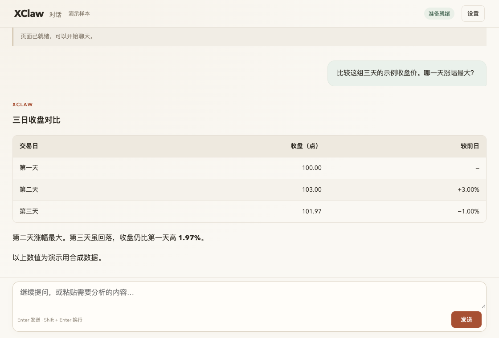

# XClaw

[中文手册](README.md) · [Reproduce the demo](docs/demo/README.md) · [Contributing](CONTRIBUTING.md) · [Share first-use feedback](https://github.com/dustturtle/XClaw/issues/new?title=First-use+feedback+%2F+%E9%A6%96%E6%AC%A1%E4%BD%93%E9%AA%8C%E5%8F%8D%E9%A6%88&body=What+did+you+try%3F+%E6%83%B3%E5%AE%8C%E6%88%90%E4%BB%80%E4%B9%88%EF%BC%9F%0A%0AWhat+worked+or+where+did+you+get+stuck%3F+%E5%93%AA%E4%B8%80%E6%AD%A5%E9%A1%BA%E5%88%A9%EF%BC%8C%E6%88%96%E5%8D%A1%E5%9C%A8%E5%93%AA%E9%87%8C%EF%BC%9F%0A%0APlease+use+a+made-up+example.+Omit+credentials%2C+personal+details%2C+holdings%2C+real+chats+and+logs.+%E8%AF%B7%E4%BD%BF%E7%94%A8%E8%99%9A%E6%9E%84%E7%A4%BA%E4%BE%8B%EF%BC%8C%E5%8B%BF%E8%B4%B4%E5%87%AD%E6%8D%AE%E3%80%81%E4%B8%AA%E4%BA%BA%E4%BF%A1%E6%81%AF%E3%80%81%E6%8C%81%E4%BB%93%E3%80%81%E7%9C%9F%E5%AE%9E%E5%AF%B9%E8%AF%9D%E6%88%96%E6%97%A5%E5%BF%97%E3%80%82)

XClaw is a self-hosted Python agent for chat, task automation and market research. Ask questions in the web client or connect a messaging adapter. The investment tools cover quotes and history for supported mainland Chinese, Hong Kong and US securities, plus selected domestic futures. Availability varies by instrument and provider.

The screenshot uses a fixed question and answer. The real chat renderer formats the table; the fixture contacts neither a model nor a market-data provider.

Web chat can also interleave prose and a chart backed by a tool result. [See the synthetic five-day chart, configuration and build guide](docs/openui.md).

## Run locally

Use Python 3.12 or newer. The Dockerfile on this branch uses Python 3.11, below the package requirement.

~~~sh
git clone https://github.com/dustturtle/XClaw.git
cd XClaw
python3.12 -m venv .venv
. .venv/bin/activate
python -m pip install -e .
xclaw setup
xclaw start --config xclaw.config.yaml
~~~

Choose a provider supported by your environment, its model ID and the matching API endpoint. Hosted providers may require a key; Ollama requires a running local model. Open **http://127.0.0.1:8080/** when using the default Web port. Start with a simple text question, then ask for a price history with an explicit symbol and date range.

## How a request runs

1. A channel adapter passes the message and chat identity to the runtime.
2. The configured model requests tools as needed. For mainland Chinese historical prices, the source chain tries pytdx, baostock, yfinance and AkShare. A quote, a historical close and an intraday observation may have different timestamps.
3. The agent receives tool results and returns an answer through the originating channel. SQLite stores local chat and business records. Optional skills, MCP servers and scheduled tasks extend this path.

The Chinese manual covers model configuration, channels, tools, backtests, storage and scheduling. Keep the Web listener on loopback for a local trial. Configure authentication before sharing the service. A hosted model can receive prompts, conversation context and tool results; data providers receive the instruments queried. Review those boundaries before entering holdings or attaching files.

## Build and test

~~~sh
uv sync --extra dev
uv build
uv run python -m pytest tests/ -v
~~~

[GitHub Actions](https://github.com/dustturtle/XClaw/actions/workflows/uv-ci.yml) reports build and test results per run. Provider credentials, market hours and upstream availability affect live behavior. [MIT license](LICENSE).
