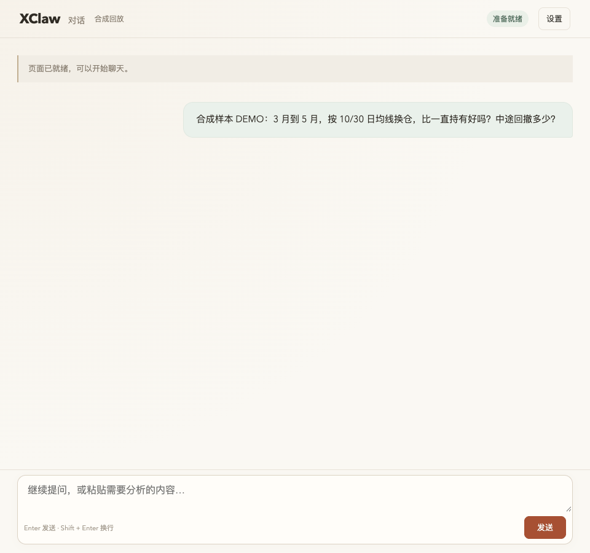
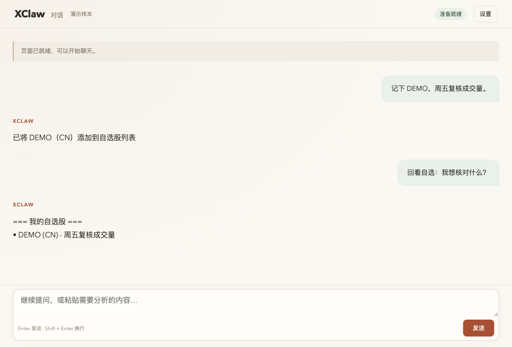
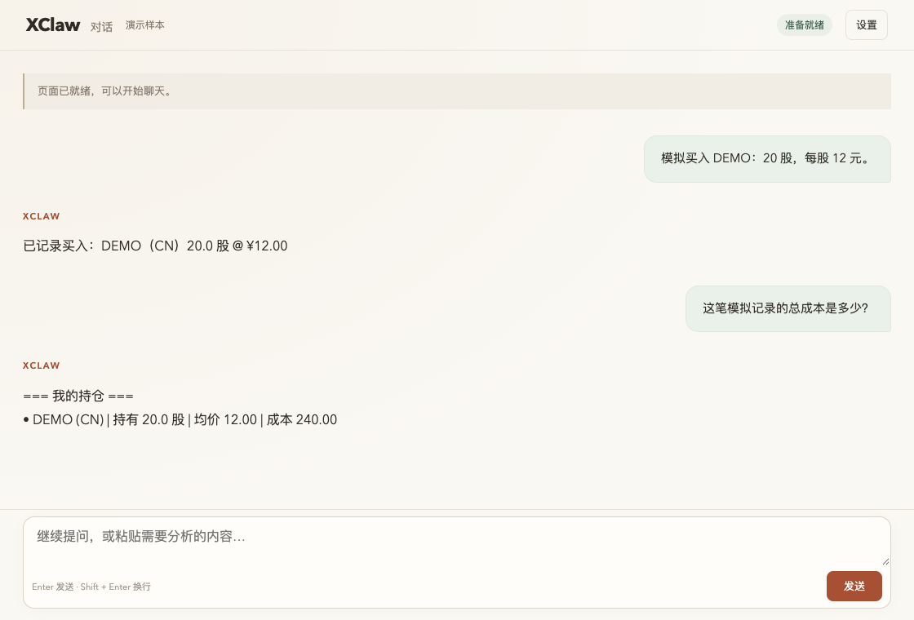

# XClaw

Would a trading rule have helped? Compare it with holding through the same period, then inspect the trades in XClaw’s self-hosted research chat.

[中文](README.md) · [First run](#run-locally) · [Low-bandwidth still](docs/demo/backtest.png)

**Would switching on a 10/30-day moving-average crossover have beaten holding from March through May?** Across 65 synthetic weekday closes from March 3 to May 30, 2025, the strategy lost 8.69%, versus 1.14% for buy-and-hold. Strategy drawdown reached 12.34%. The ledger shows an April 28 purchase at 112.69 and a May 28 sale at 108.15.

This 13.5-second deterministic replay uses the main-branch backtest tool and Web client. Prices are generated, questions are scripted and frame durations are fixed. The example illustrates a research method and provides no investment recommendation. [Reproduce the results](docs/demo/README.md)

**First run** · With Python 3.12+ in the checkout, run `python -m pip install -e .`, then `xclaw setup` and `xclaw start --config xclaw.config.yaml`.

### Why was this on my watchlist?

Save the fictional symbol DEMO with the note “check volume on Friday.” Ask for the list again and the original note comes back alongside the symbol.

### What did my paper position cost?

Record 20 shares at 12 yuan each. Viewing the position reads back the share count and average cost and calculates the total of 240 yuan.

Both replays use fixed questions, run the actual tools against fresh in-memory databases and display their output in the Web chat renderer. No model key is needed for the replays.

## Run locally

Use Python 3.12 or newer. The Dockerfile on this branch uses Python 3.11, below the package requirement.

~~~sh
git clone https://github.com/dustturtle/XClaw.git
cd XClaw
python3.12 -m venv .venv
. .venv/bin/activate
python -m pip install -e .
xclaw setup
xclaw start --config xclaw.config.yaml
~~~

Choose a provider supported by your environment, its model ID and the matching API endpoint. Hosted providers may require a key; Ollama requires a running local model. Open **http://127.0.0.1:8080/** when using the default Web port. Start with a simple text question, then ask for a price history with an explicit symbol and date range.

## How a request runs

1. A channel adapter passes the message and chat identity to the runtime.
2. The configured model requests tools as needed. For mainland Chinese historical prices, the source chain tries pytdx, baostock, yfinance and AkShare. A quote, a historical close and an intraday observation may have different timestamps.
3. The agent receives tool results and returns an answer through the originating channel. SQLite stores local chat and business records. Optional skills, MCP servers and scheduled tasks extend this path.

The Chinese manual covers model configuration, channels, tools, backtests, storage and scheduling. Keep the Web listener on loopback for a local trial. Configure authentication before sharing the service. Watchlists and holdings are stored in local SQLite. When you use a hosted model, its provider can receive the current message, history and memory included in context, and tool results. Listing a watchlist can expose symbols and notes. Viewing holdings can expose share counts and costs. Market-data providers receive the instruments queried. Review those boundaries before entering holdings or attaching files.

## Build and test

~~~sh
uv sync --extra dev
uv build
uv run python -m pytest tests/ -v
~~~

[GitHub Actions](https://github.com/dustturtle/XClaw/actions/workflows/uv-ci.yml) reports build and test results per run. Provider credentials, market hours and upstream availability affect live behavior. [MIT license](LICENSE).
