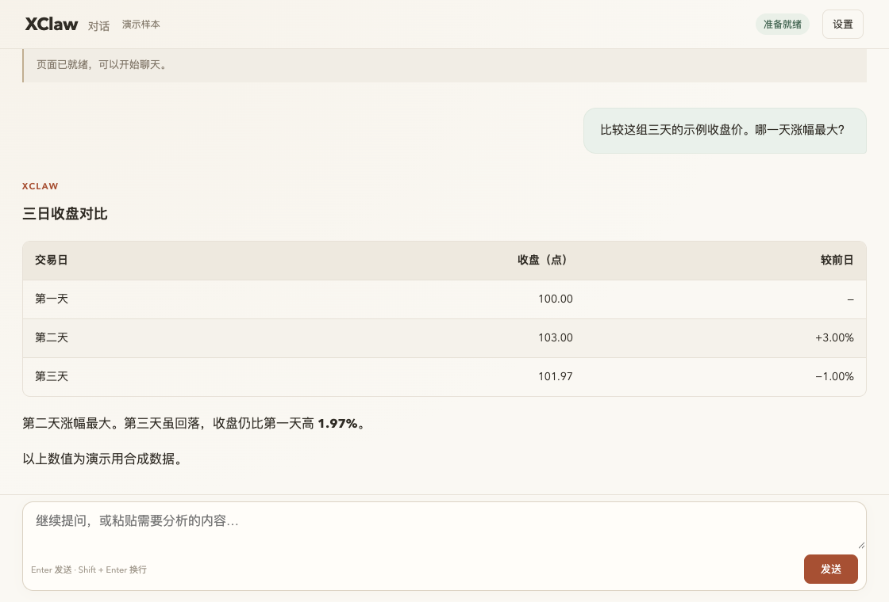

# Reproduce the chat screenshot

This fixture loads the project's own chat page, stylesheet and Markdown renderer. It supplies one fixed question and answer directly to the message renderer. It exercises presentation only. There is no server, database, live quote, tool execution or model call.

After installing the project in a virtual environment, run from the repository root with a local Chrome or Chromium executable:

~~~sh
python docs/demo/render.py --chrome /path/to/chromium --output docs/demo/chat.png
~~~

Chrome uses a temporary browser profile and renders a 1120 × 760 viewport. Fonts can differ between operating systems. The prices 100.00, 103.00 and 101.97 are synthetic. The daily percentage changes are +3% and −1%.

For the evidence-backed chart fixture, see the [OpenUI demo](../openui.md).

[Share first-use feedback / 反馈首次体验](https://github.com/dustturtle/XClaw/issues/new?title=First-use+feedback+%2F+%E9%A6%96%E6%AC%A1%E4%BD%93%E9%AA%8C%E5%8F%8D%E9%A6%88&body=What+did+you+try%3F+%E6%83%B3%E5%AE%8C%E6%88%90%E4%BB%80%E4%B9%88%EF%BC%9F%0A%0AWhat+worked+or+where+did+you+get+stuck%3F+%E5%93%AA%E4%B8%80%E6%AD%A5%E9%A1%BA%E5%88%A9%EF%BC%8C%E6%88%96%E5%8D%A1%E5%9C%A8%E5%93%AA%E9%87%8C%EF%BC%9F%0A%0APlease+use+a+made-up+example.+Omit+credentials%2C+personal+details%2C+holdings%2C+real+chats+and+logs.+%E8%AF%B7%E4%BD%BF%E7%94%A8%E8%99%9A%E6%9E%84%E7%A4%BA%E4%BE%8B%EF%BC%8C%E5%8B%BF%E8%B4%B4%E5%87%AD%E6%8D%AE%E3%80%81%E4%B8%AA%E4%BA%BA%E4%BF%A1%E6%81%AF%E3%80%81%E6%8C%81%E4%BB%93%E3%80%81%E7%9C%9F%E5%AE%9E%E5%AF%B9%E8%AF%9D%E6%88%96%E6%97%A5%E5%BF%97%E3%80%82)
