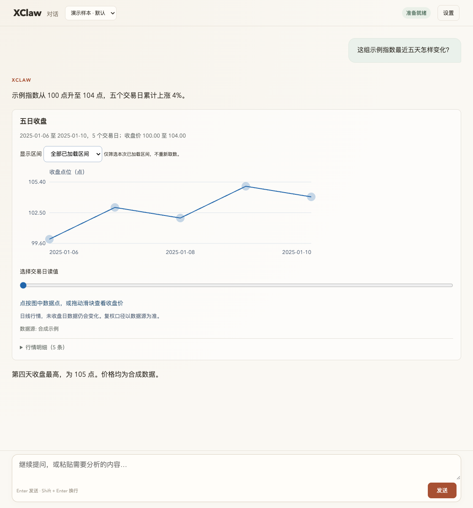

# Evidence-backed OpenUI cards

OpenUI is an optional presentation layer for Web chat. Text remains readable when a chart cannot be rendered. In inline mode the server can send text and a read-only card in the same answer. A history card displays the values returned by a matching tool call. A saved answer can be reopened from its evidence snapshot. Explicit refresh may contact the data provider and return different values.

## Try the fixture

From a source checkout, install the Python project and run the following with Node.js 22 and a local Chromium browser:

~~~sh
npm --prefix frontend ci --ignore-scripts
npm --prefix frontend run build
python docs/demo/render.py --openui --chrome /path/to/chromium
~~~

The fixture sends three fixed presentation updates and a final snapshot to the production browser host. It uses synthetic prices, a stubbed model list and no live account, model or data provider. The screenshot shows the final frame. Font metrics may differ by platform.

## Enable it for your own chat

After building the frontend, copy the settings you need from [the example](../xclaw.openui.example.yaml) into a local config. Supply the model ID and explicit Responses-compatible endpoint you control. Set the credential through the environment or your secret manager. The example endpoint is deliberately non-routable. Start with a separate data directory and loopback listener.

Enable `openui_enabled` for presentation cards and `openui_inline_stream` for inline records on supported native Web requests. Configure `web_model_options` to offer additional model IDs on the native Responses backend. A selection applies to the new request. A remote model can receive prompts, relevant history and tool results. Evidence and confirmed action receipts may be stored locally; protect the data directory. Local watchlist and portfolio operations can change those records. The chart fixture uses only read-only evidence. Web writes require a matching saved action plan or a verifiable saved legacy button, including in a new chat.

## Build a distribution

From a clean checkout with Node.js 22, npm, Python 3.12+ and uv:

~~~sh
npm --prefix frontend ci --ignore-scripts
npm --prefix frontend run typecheck
npm --prefix frontend test
npm --prefix frontend run build
uv sync --frozen --extra dev
uv build
uv run python scripts/check_openui_wheel.py dist
uv run python -m pytest tests/
~~~

The verifier compares the browser assets and third-party notices in the wheel with the frontend build output. Build the frontend before enabling OpenUI from source. Turning both flags off returns Web chat to text mode.

This source-review draft leaves the existing GitHub workflow and its entry script unchanged. Integration of the frontend build and wheel checks into CI is pending.
