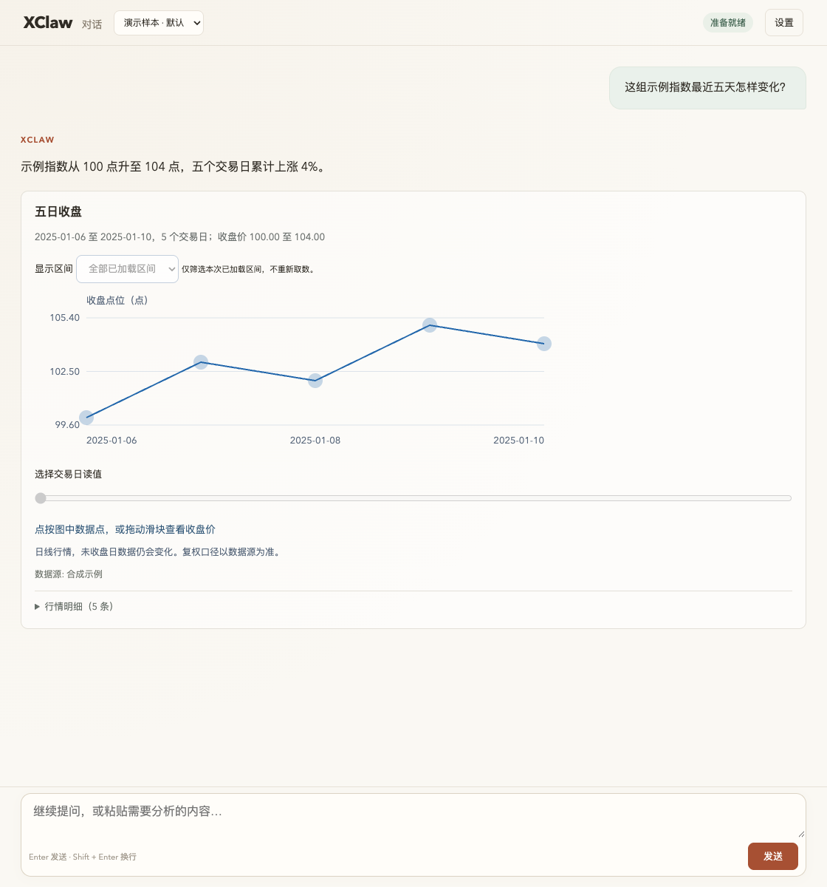

# Evidence-backed OpenUI cards

OpenUI is an optional presentation layer for Web chat. Text remains readable when a chart cannot be rendered. In inline mode the server can send text and a read-only card in the same answer. A history card displays the values returned by a matching tool call. A saved answer can be reopened from its evidence snapshot. Explicit refresh may contact the data provider and return different values.

**1. The chart appears before the closing paragraph.**

**2. The final answer includes the closing paragraph.**

## Try the fixture

From a source checkout, install the Python project and run the following with Node.js 22 and a local Chromium browser:

~~~sh
npm --prefix frontend ci --ignore-scripts
npm --prefix frontend run build
python docs/demo/render.py --openui --chart-preview --output docs/demo/openui-preview.png --chrome /path/to/chromium
python docs/demo/render.py --openui --chrome /path/to/chromium
~~~

The fixture sends three fixed presentation updates and a final snapshot to the production browser host. It uses synthetic prices, a stubbed model list and no live account, model or data provider. These two frames replay a deterministic sequence. Their spacing conveys no model or network timing. Font metrics may differ by platform.

## Enable it for your own chat

After building the frontend, copy the settings you need from [the example](../xclaw.openui.example.yaml) into a local config. Supply the model ID and explicit Responses-compatible endpoint you control. Set the credential through the environment or your secret manager. The example endpoint is deliberately non-routable. Start with a separate data directory and loopback listener.

Enable `openui_enabled` for presentation cards and `openui_inline_stream` for inline records on supported native Web requests. Configure `web_model_options` to offer additional model IDs on the native Responses backend. A selection applies to the new request. A remote model can receive prompts, relevant history and tool results. Evidence and confirmed action receipts may be stored locally; protect the data directory. Local watchlist and portfolio operations can change those records. The chart fixture uses only read-only evidence. Web writes require a matching saved action plan or a verifiable saved legacy button, including in a new chat.

## Build a distribution

From a clean checkout with Node.js 22, npm, Python 3.12+ and uv:

~~~sh
npm --prefix frontend ci --ignore-scripts
npm --prefix frontend run typecheck
npm --prefix frontend test
npm --prefix frontend run build
uv sync --frozen --extra dev
uv build
uv run python scripts/check_openui_wheel.py dist
uv run python -m pytest tests/
~~~

The verifier compares the browser assets and third-party notices in the wheel with the frontend build output. Build the frontend before enabling OpenUI from source. Turning both flags off returns Web chat to text mode.

This source-review draft leaves the existing GitHub workflow and its entry script unchanged. Integration of the frontend build and wheel checks into CI is pending.

[Share first-use feedback / 反馈首次体验](https://github.com/dustturtle/XClaw/issues/new?title=First-use+feedback+%2F+%E9%A6%96%E6%AC%A1%E4%BD%93%E9%AA%8C%E5%8F%8D%E9%A6%88&body=What+did+you+try%3F+%E6%83%B3%E5%AE%8C%E6%88%90%E4%BB%80%E4%B9%88%EF%BC%9F%0A%0AWhat+worked+or+where+did+you+get+stuck%3F+%E5%93%AA%E4%B8%80%E6%AD%A5%E9%A1%BA%E5%88%A9%EF%BC%8C%E6%88%96%E5%8D%A1%E5%9C%A8%E5%93%AA%E9%87%8C%EF%BC%9F%0A%0APlease+use+a+made-up+example.+Omit+credentials%2C+personal+details%2C+holdings%2C+real+chats+and+logs.+%E8%AF%B7%E4%BD%BF%E7%94%A8%E8%99%9A%E6%9E%84%E7%A4%BA%E4%BE%8B%EF%BC%8C%E5%8B%BF%E8%B4%B4%E5%87%AD%E6%8D%AE%E3%80%81%E4%B8%AA%E4%BA%BA%E4%BF%A1%E6%81%AF%E3%80%81%E6%8C%81%E4%BB%93%E3%80%81%E7%9C%9F%E5%AE%9E%E5%AF%B9%E8%AF%9D%E6%88%96%E6%97%A5%E5%BF%97%E3%80%82)
